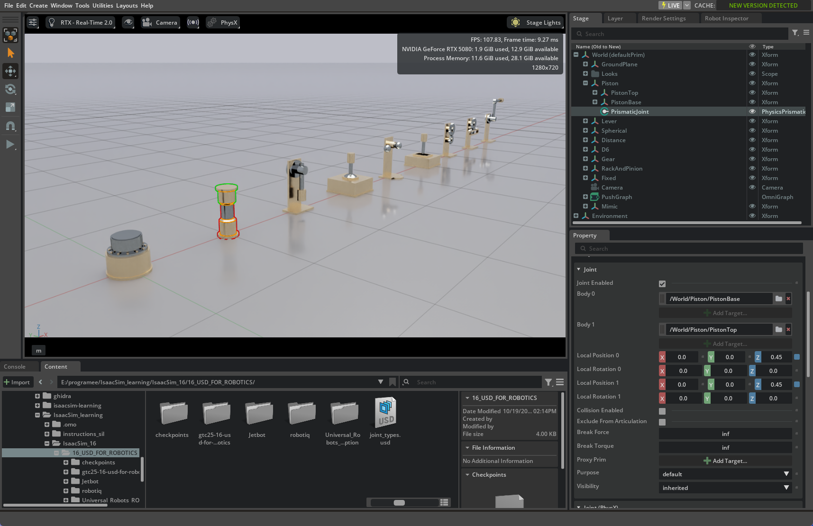

# 图片目录规范

## 最终图片

- `docs/shared/assets/`：跨 Lab 的基础图片（day01）
- `docs/lab16/assets/`：Lab16 教程引用的最终图片（day02-day06）
- `docs/lab19/assets/`：Lab19 教程引用的最终图片（待补）

章节里统一用相对路径：

```markdown

```

## 原始图片

- `docs/assets/raw/`：从 `work/screenshots/` 迁移的原始截图，作为素材归档，不直接引用。

## 命名

```text
dayXX_<主题>.png
```

- 宽度 1200-1600px
- PNG
- 单张 < 1MB

## 已有 Lab16 图片

| 文件 | 内容 | 章节 |
|---|---|---|
| `shared/assets/day01_joint_types.png` | joint_types.usd | shared/01 |
| `shared/assets/day01_cube_fall.png` | 立方体下落 | shared/01 |
| `lab16/assets/day02_import_options.png` | URDF Import options | lab16/02 |
| `lab16/assets/day02_gain_tuner.png` | Gain Tuner | lab16/02 |
| `lab16/assets/day02_snap_limits.png` | Snap to Limits | lab16/02 |
| `lab16/assets/day02_ur10_stage.png` | UR10e Stage | lab16/02 |
| `lab16/assets/day03_gripper_initial.png` | 夹爪初始 | lab16/03 |
| `lab16/assets/day03_gripper_target40.png` | 夹爪闭合 | lab16/03 |
| `lab16/assets/day03_gripper_play.png` | 夹爪 Play | lab16/03 |
| `lab16/assets/day04_*.png` | 组装过程 | lab16/04 |
| `lab16/assets/day05_*.png` | Jetbot 优化 | lab16/06 |
