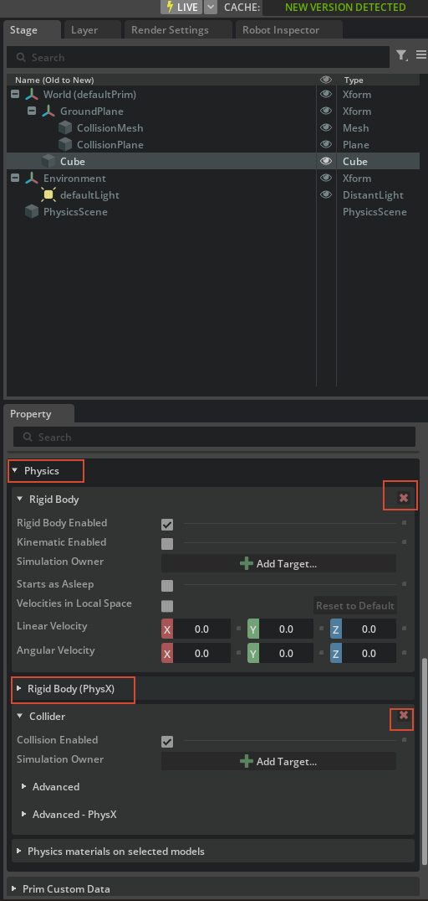

# Lab16 M1：机器人资产结构

> 目标：看懂 UR10e / 2F-140 的 USD 结构，知道哪些 Prim 是刚体、哪些只是 Transform、夹爪应该锚到哪里。

---

## 1. URDF 与 USD

URDF 描述：

- Link：连杆/刚体
- Joint：关节
- Visual / Collision：外观与碰撞

导入 USD 后：

- Link → `Xform` + `PhysicsRigidBodyAPI` + `PhysicsMassAPI`
- Joint → `PhysicsRevoluteJoint` / `PhysicsPrismaticJoint` / `PhysicsFixedJoint`
- 整棵关节树 → **Articulation**

---

## 2. UR10e 的关键 Prim

| Prim | 作用 | 注意 |
|---|---|---|
| `base_link` | Xform | **不是刚体** |
| `base_link_inertia` | 真正的基座刚体 | `base_fixed_joint` 锚这里 |
| `wrist_3_link` | 腕部刚体 | 夹爪固定到这里 |
| `tool0` | 工具坐标系 | **不是刚体**，不能直接做 Fixed Joint 的 body |
| `flange` | 法兰 | 中间 Transform |

### 记忆

```text
固定机器人 → base_link_inertia
固定夹爪   → wrist_3_link
tool0      → 只是 frame
```

---

## 3. 2F-140 的关键 Prim

| Prim | 作用 |
|---|---|
| `robotiq_arg2f_base_link` | 夹爪基座刚体 |
| `finger_joint` | 唯一主动关节 |
| `left/right_inner_knuckle_joint` | 闭链内侧支架关节 |
| `left/right_inner_finger_joint` | 内侧指尖关节 |
| `right_outer_knuckle_joint` | 外侧随动关节 |
| `root_joint` | 夹爪单独使用时固定到 world |

夹爪完整拓扑见 [03 2F-140 夹爪](03_robotiq_gripper.md)。

---

## 4. 资产结构

一个 URDF 导入资产通常是：

```text
ur10.usda
├─ payloads/base.usda
├─ payloads/geometries.usd
├─ payloads/instances.usda
├─ payloads/materials.usda
└─ payloads/Physics/
   ├─ physics.usda
   ├─ physx.usda
   └─ mujoco.usda
```

根层只放：

- 导入后的调参
- 关节覆盖
- 组装时的 Fixed Joint

不要在 `payloads/` 原始层里写业务调参。

---

## 5. Layers 与 References

- **Sublayer**：同一资产的多层覆盖
- **Reference**：把另一个资产放到当前 Prim 下
- **Payload**：延迟加载的引用，适合大资产

Lab16 的组装就是：

```text
ur10_with_gripper.usda
├─ reference: ur10.usda
└─ reference: robotiq_2f_140.usda
```

夹爪通过 `gripper_fixed_joint` 连到 `wrist_3_link`。

---

## 6. joint_types.usd 练习

打开：

```text
<ISAAC_16_ROOT>/16_USD_FOR_ROBOTICS/joint_types.usd
```

识别至少 5 种关节：

- Prismatic
- Revolute
- Spherical
- Distance
- D6
- Fixed
- Gear
- Rack and Pinion
- Mimic



---

## 7. 验证清单

- [x] 能说出 URDF Link / Joint 对应 USD 的什么
- [x] 知道 `base_link_inertia` 才是基座刚体
- [x] 知道 `wrist_3_link` 才是夹爪安装刚体
- [x] 知道 `tool0` 只是 frame
- [x] 能解释 Sublayer / Reference / Payload
- [x] 能在 `joint_types.usd` 里识别至少 5 种关节

---

## 8. 下一步

- [02 UR10e 导入 + Gain Tuner](02_ur10e_import_gain_tuner.md)
- [03 2F-140 夹爪](03_robotiq_gripper.md)
