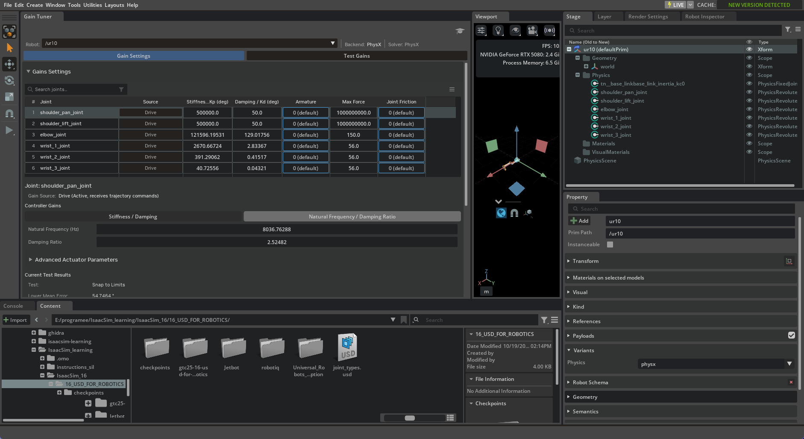
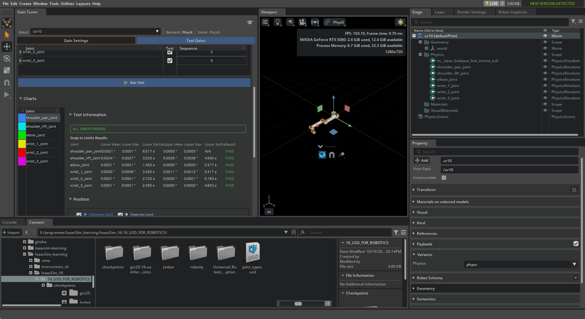
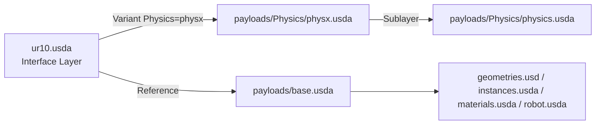
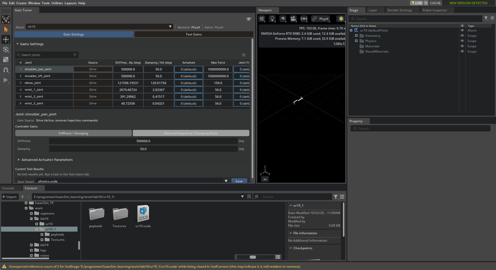

# Day 2 — 导入 UR10e 并用 Gain Tuner 调关节增益

> 版本：Isaac Sim 6.1.0.0 / Isaac Lab 3.0.0
> 日期：2026-10-22
> 预计耗时：60-90 分钟
> 官方参考：
> - Import URDF：https://docs.isaacsim.omniverse.nvidia.com/6.1.0/importer_exporter/import_urdf.html
> - Tutorial 6 Setup a Manipulator：https://docs.isaacsim.omniverse.nvidia.com/6.1.0/robot_setup_tutorials/tutorial_import_assemble_manipulator.html
> - Tutorial 11 Tuning Joint Drive Gains：https://docs.isaacsim.omniverse.nvidia.com/6.1.0/robot_setup_tutorials/joint_tuning.html

---

## 1. 目标

学完这一章，你能：

- [ ] 把 UR10e 的 URDF 正确导入成 USD
- [ ] 理解 6.1 导入器**没有 Natural Frequency**，改用 Gain Tuner
- [ ] 把 Physics Variant 设为 `physx`
- [ ] 用 Gain Tuner 把 6 个关节调到稳定
- [ ] 用 Snap to Limits 验证关节增益
- [ ] 看懂 Asset Structure 3.0 的目录，以及“根层覆盖 payload 层”

---

## 2. 前置条件

- 已完成 Day 1（Stage / Prim / 物理基础）
- 环境：`conda activate isaacsim`
- 修复版 URDF：`work/lab16/ur10/ur10.urdf`
- 空 Stage

---

## 3. 为什么需要修复 URDF 网格路径

原始的 `urdf/ur10.urdf` 里写的是：

```xml
<mesh filename="meshes/ur10/visual/base.dae"/>
```

导入器会按 **URDF 所在目录**（`urdf/`）去解析，拼成 `urdf/meshes/...`，但真实网格在上一级的 `meshes/`。

所以直接导入原始 URDF 会出现**网格丢失**。

修复方式：把相对路径改成绝对路径，生成：

`work/lab16/ur10/ur10.urdf`

（14 个网格全部存在，已预验证。）

> 结论：**导入修复版，不要导入原始 `urdf/ur10.urdf`。**

---

## 4. Import 设置（Isaac Sim 6.1）

1. `File > New`
2. `File > Import`
3. 选择修复版 `work/lab16/ur10/ur10.urdf`

| 选项 | 填什么 | 原因 |
|---|---|---|
| **USD Output** | `work/lab16/ur10` | 输出到工作区，不污染源目录 |
| **ROS Package List** | 留空 | 修复版用绝对路径 |
| **Collision From Visuals** | 不勾 | URDF 自带 collision 网格 |
| **Allow Self-Collision** | 先不勾 | 避免自碰撞抖动 |
| **Robot Type** | **Manipulator** | 官方 Tutorial 6 |
| **Base Type** | **Fixed** | 固定基座；官方 Tutorial 6 |
| **Add Reference to Stage** | 不勾 | 新建 stage |
| **Merge Mesh** | 不勾 | 资产优化在后续章节做 |
| **Debug Mode** | 不勾 | |

点 **Import**。

> 注意：如果 `work/lab16/ur10` 已存在，导入器会自动生成 `ur10_1`。
> 本次实际资产在：`work/lab16/ur10_1/ur10.usda`


---

## 5. 把 Physics Variant 设为 physx

6.1 的资产是**多物理后端结构**，导入后可能没有自动选中物理变体。

1. Stage 里选中根 prim `/ur10`
2. Property 面板找 **Variants**
3. **Physics = `physx`**

> 不设的话，PhysX 的关节驱动可能不生效，机器人行为会不对。

---

## 6. Gain Tuner：6.1 的关节增益入口

6.1 的 URDF 导入器**默认把所有关节 Stiffness/Damping 设为 0**。所以直接 Play，机器人会软塌——这是正常的，不是导入失败。

打开：

**Tools > Robotics > Asset Editors > Gain Tuner**



你会看到 6 个关节：

```
shoulder_pan_joint
shoulder_lift_joint
elbow_joint
wrist_1_joint
wrist_2_joint
wrist_3_joint
```

### 两种调法

#### 方法 A：Natural Frequency / Damping Ratio（逐关节）

1. 选一个关节
2. 右侧切到 **Natural Frequency / Damping Ratio**
3. 填 **300 / 1.0**
4. 换下一个关节，重复 6 次

> 多选时这个面板会隐藏，提示 “edit gains directly in the table”，所以只能逐个设。

#### 方法 B：Stiffness / Damping（官方 Tutorial 11 表）

| Joint | Stiffness | Damping |
|---|---|---|
| shoulder_pan_joint | 500000 | 50 |
| shoulder_lift_joint | 500000 | 50 |
| elbow_joint | 50000 | 50 |
| wrist_1_joint | 500 | 0.5 |
| wrist_2_joint | 500 | 0.5 |
| wrist_3_joint | 50 | 0.0 |

本次实测组合：

- shoulder 两个用官方值 **500000 / 50**
- elbow / wrist 用 300 Hz / 1.0 换算出来的值（也能 PASS，保留即可）

### 关键：shoulder 的 Max Force

URDF 里 shoulder 的 Max Force 是 **330 Nm**，不够抬起整条手臂。官方 Tutorial 11 明确说：

> UR10 的 `shoulder_pan_joint` 和 `shoulder_lift_joint` 需要把 Max Force 设为 `inf` 才能通过 Snap to Limits。

6.1 的数值输入框不接受字符串 `inf`，所以填：

```
1000000000
```

（1e9，等效无限。）

位置：Gain Tuner 里选中关节 → **Advanced Actuator Parameters > Max Drive Force**。

### 保存

点右下角 **Save**，Save Target 是 `physics.usda`。

---

## 7. Test Gains / Snap to Limits

1. 切到 **Test Gains** 标签
2. 勾选 6 个关节
3. **Test Mode = Snap to Limits**
4. 点 **Run Test**



结果含义：

| 结果 | 含义 |
|---|---|
| PASS | 到达限位并稳定 |
| FAIL | 没到达/没稳定（增益或力矩不够） |
| Blocked | 碰撞体挡住，到不了限位 |

本次第一次测试：shoulder 两个 FAIL，其余 PASS。
把 shoulder 改成 **500000 / 50 + Max Force 1e9** 后：**ALL JOINTS PASSED**。

---

## 8. 一个重要的 USD 知识点：1e9 到底存哪了

保存后检查文件，会发现：

- `payloads/Physics/physics.usda`：`maxForce = 330`
- `ur10.usda`（根层/接口层）：`maxForce = 1000000000`

为什么运行时用 1e9？因为 **USD 层强度：根层覆盖 payload 层**。

```text
ur10.usda（Interface Layer，最强）
  └── Variant Physics = physx
        └── payload physx.usda
              └── sublayer physics.usda（maxForce=330，被根层覆盖）
```

Mermaid 版本：



> 结论：**1e9 是持久化的**，只是在根层，不是 physics.usda。
> 如果你想把调参写进 physics.usda，可以在 Layer 面板把 `physics.usda` 设为 Authoring Layer 再改；但不是必须。

---

## 9. Asset Structure 3.0

导入后的目录：

```text
work/lab16/ur10_1/
├── ur10.usda                 ← 接口层，打开这个
├── Textures/
└── payloads/
    ├── base.usda             ← 层级/变换
    ├── geometries.usd        ← 网格
    ├── instances.usda        ← 视觉/碰撞实例
    ├── materials.usda        ← 材质
    ├── robot.usda            ← Robot Schema 元数据
    └── Physics/
        ├── physics.usda      ← 引擎无关物理（drive/关节/质量）
        ├── physx.usda        ← PhysX 专用
        └── mujoco.usda       ← MuJoCo 专用
```



---

## 10. 预期结果

- Play 后机器人保持姿态，不塌
- Gain Tuner 6 个关节都有非零增益
- Snap to Limits：**ALL JOINTS PASSED**
- 资产在 `work/lab16/ur10_1/ur10.usda`

---

## 11. 踩坑记录

| 现象 | 原因 | 解决 |
|---|---|---|
| Play 后机器人软塌 | 6.1 导入器默认 gains=0 | Gain Tuner 调增益 |
| 网格丢失 | 原始 URDF 相对路径按 urdf/ 解析 | 用修复版 `work/lab16/ur10/ur10.urdf` |
| Gain Tuner 看不到机器人 | 根 prim 没有 Robot Schema | 用 URDF 重新导入（自动加 Robot Schema） |
| 机器人不动 | Physics Variant 没选 physx | Variants > Physics = physx |
| Max Force 输不了 `inf` | 数值输入框只接受数字 | 填 `1e9` |
| shoulder Snap to Limits FAIL | 330 Nm 不够 | 500000/50 + Max Force 1e9 |
| `wrist_1 = 300.00001` | 浮点往返误差 | 忽略，1e-5 无影响 |
| 底部 `Unexpected reference count of 2...` | stage 关闭时仍被引用 | 无害；重启 Isaac Sim 即可 |

---

## 12. 验证清单

- [ ] 资产在 `work/lab16/ur10_1/ur10.usda`
- [ ] 根 prim `/ur10` 的 Physics Variant = `physx`
- [ ] 6 个关节都有非零 Stiffness/Damping
- [ ] shoulder 两个 Max Force = `1e9`
- [ ] Snap to Limits：ALL JOINTS PASSED
- [ ] Play 后机器人保持姿态
- [ ] 截图已存 `assets/day02_*.png`

---

## 13. 英文词汇

| English | 中文 | 说明 |
|---|---|---|
| Import options | 导入选项 | URDF 导入设置 |
| USD Output | USD 输出目录 | 生成的 USD 放哪 |
| Robot Type: Manipulator | 机器人类型：机械臂 | |
| Base Type: Fixed | 基座类型：固定 | |
| Physics Variant | 物理变体 | physx / mujoco / none |
| Gain Tuner | 增益调节器 | 调关节 PD 增益 |
| Natural Frequency | 固有频率 | Hz |
| Damping Ratio | 阻尼比 | 无量纲 |
| Stiffness / Damping | 刚度 / 阻尼 | Kp / Kd |
| Max Force / Max Drive Force | 最大力 / 最大驱动力 | |
| Snap to Limits | 到限位测试 | |
| Authoring Layer | 创作层 | 当前写入的 USD 层 |
| Override | 覆盖 | 强层覆盖弱层 |

---

## 14. 下一步

→ [Day 3 — 导入 Robotiq 2F-140 夹爪](03_robotiq_gripper.md)（待补）
