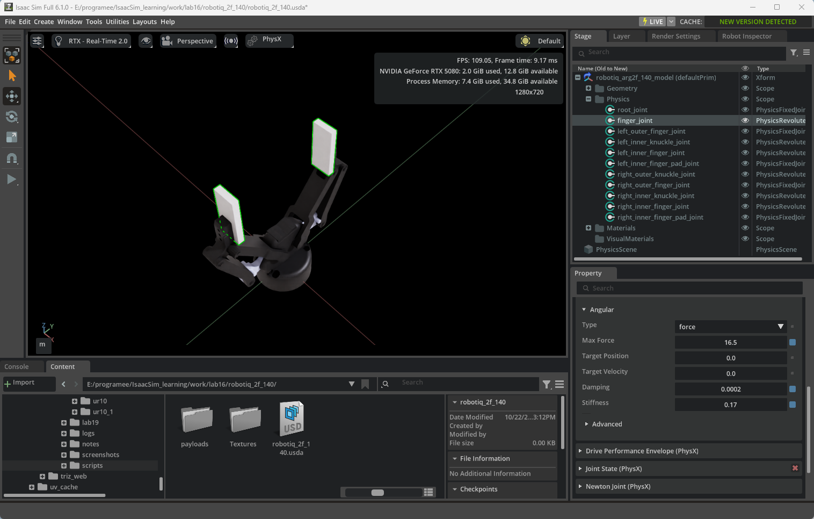
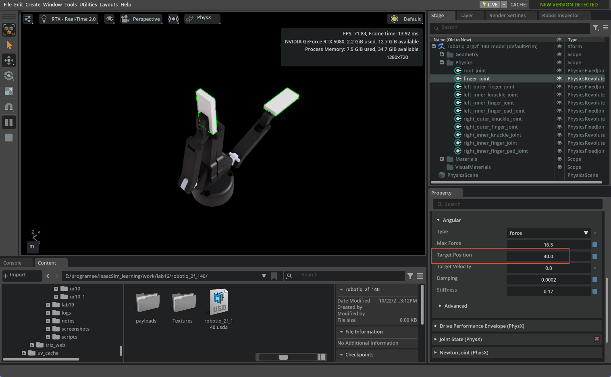
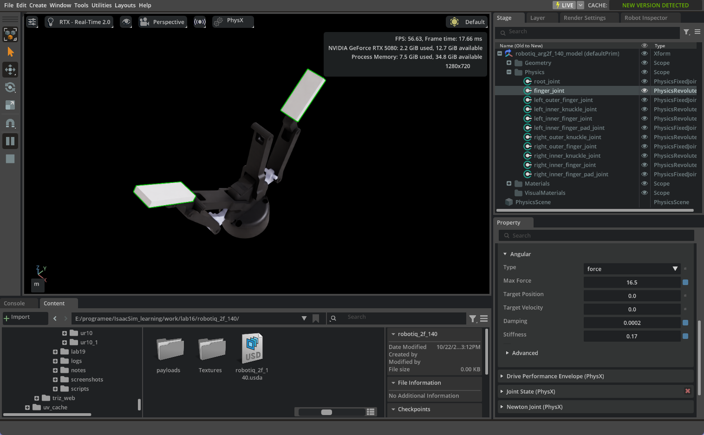

# Day 3 — 导入 Robotiq 2F-140 夹爪（Isaac Sim 6.1 / PhysX）

> 版本：Isaac Sim 6.1.0.0 / Isaac Lab 3.0.0
> 日期：2026-10-22
> 预计耗时：45-60 分钟
> 官方参考：
> - Import URDF：https://docs.isaacsim.omniverse.nvidia.com/6.1.0/importer_exporter/import_urdf.html
> - Tutorial 10 Rig Closed-Loop Structures：https://docs.isaacsim.omniverse.nvidia.com/6.1.0/robot_setup_tutorials/rig_closed_loop_structures.html
> - Tutorial 11 Tuning Joint Drive Gains：https://docs.isaacsim.omniverse.nvidia.com/6.1.0/robot_setup_tutorials/joint_tuning.html

---

## 1. 目标

学完这一章，你能：

- [ ] 导入 Robotiq 2F-140 夹爪
- [ ] 理解 1 个主动关节 + 5 个 Mimic 关节
- [ ] 修复 6.1 在 PhysX 下的 Mimic 缺失问题
- [ ] Play 后夹爪稳定，不塌
- [ ] 改 `finger_joint` 目标位置时，两指一起开合

---

## 2. 前置条件

- 已完成 Day 2（UR10e 导入 + Gain Tuner）
- 环境：`conda activate isaacsim`
- 夹爪 URDF：
  `<repo>/IsaacSim_16/16_USD_FOR_ROBOTICS/robotiq/robotiq_2f_140_gripper_visualization/2f_140/urdf/robotiq_2f_140.urdf`
- 该 URDF 的 `../meshes/...` 路径已验证全部有效，不需要修复。

---

## 3. Import 设置

1. `File > New`
2. `File > Import`
3. 选择上面的 `robotiq_2f_140.urdf`

| 选项 | 填什么 | 原因 |
|---|---|---|
| **USD Output** | `work/lab16/robotiq_2f_140` | 输出到工作区 |
| **ROS Package List** | 留空 | URDF 用相对路径 `../meshes` |
| **Collision From Visuals** | 不勾 | URDF 自带 collision 网格 |
| **Allow Self-Collision** | 先不勾 | 避免自碰撞抖动 |
| **Robot Type** | **End Effector** | 夹爪是末端执行器 |
| **Base Type** | **Fixed** | 独立测试时固定基座 |
| **Add Reference to Stage** | 不勾 | 新建 stage |
| **Merge Mesh** | 不勾 | 后续资产优化再做 |
| **Debug Mode** | 不勾 | |

Import 后：
- Stage 根 prim：`/robotiq_arg2f_140_model`
- 选中根 prim，**Physics Variant = `physx`**

> 导入截图待补（可参考 Day 2 的 Import options）。

---

## 4. 这个 URDF 里有什么

- 11 个 link、10 个 joint
- **1 个主动关节**：`finger_joint`（revolute，0 ~ 0.7 rad ≈ 40.1°）
- **5 个 Mimic 关节**：

| 关节名 | URDF mimic multiplier | PhysxMimic gearing（最终 USD） |
|---|---:|---:|
| left_inner_knuckle_joint | -1 | **+1** |
| left_inner_finger_joint | +1 | **-1** |
| right_outer_knuckle_joint | -1 | **+1** |
| right_inner_knuckle_joint | -1 | **+1** |
| right_inner_finger_joint | +1 | **-1** |

> 注意：URDF 的 multiplier 不能直接抄进 PhysxMimic。6.1 导入后的 joint frame/axis 发生了翻转，PhysxMimic 的 gearing 符号与 URDF 相反。这是 2F-140 最容易踩的坑。

- 4 个 fixed：left/right_outer_finger_joint、left/right_inner_finger_pad_joint
- `root_joint`：把夹爪 base 固定到 world（Base Type=Fixed）

> **Gain Tuner 只会显示 `finger_joint`**，这是正常的：Mimic 关节不应该有自己的 Drive。



---

## 5. 6.1 的版本陷阱：NewtonMimicAPI vs PhysxMimicJointAPI

6.1 的 URDF 导入器**故意只写 `NewtonMimicAPI`**，不再写 `PhysxMimicJointAPI`。官方 changelog 原话：

> “Imported URDF mimic joints are now expressed exclusively through NewtonMimicAPI … the transformer-driven authoring of the equivalent PhysxMimicJointAPI has been removed; the runtime consumes the Newton mimic schema directly.”

结果：

- **Newton 后端**：能识别 `NewtonMimicAPI`，夹爪正常。
- **PhysX 后端**：不认 `NewtonMimicAPI`，5 个 Mimic 关节变成“没有约束的被动关节”，一 Play 就塌。

检查你导入的资产：

```text
payloads/Physics/physics.usda
  finger_joint:                 PhysicsDriveAPI:angular
  left_inner_knuckle_joint:     NewtonMimicAPI + PhysicsDriveAPI:angular
  ...（5 个都是 NewtonMimicAPI，没有 PhysxMimicJointAPI）

payloads/Physics/physx.usda
  只加了 PhysxJointAPI，没有 PhysxMimicJointAPI
```

所以必须手动补 PhysX 的 Mimic。

### 5.1 最终结论：2F-140 用完整 5 关节 PhysxMimic

> **重要修正（2026-10-23）**：本节旧版记录的 **Physx_Loop** 方案对 2F-140 不成立，已废弃。  
> 2F-140 的黑色支架就是 `inner_knuckle`；把 inner knuckle 排除出 articulation 后，它在闭合时没有约束，会直接掉落。  
> 最终采用官方 4.5 完成版 `checkpoints/completed_arm/ur10_with_gripper.usd` 里的 5 关节 PhysxMimic 配置。

| 关节 | gearing | naturalFrequency | dampingRatio | Drive |
|---|---:|---:|---:|---|
| `finger_joint` | — | — | — | 37.5195656 / 0.00125065 / 1000 / target 0~40 |
| `left_inner_knuckle_joint` | +1 | 2500 | 0.005 | 无 |
| `right_inner_knuckle_joint` | +1 | 2500 | 0.005 | 无 |
| `right_outer_knuckle_joint` | +1 | 2500 | 0.005 | 无 |
| `left_inner_finger_joint` | -1 | 2500 | 0.005 | 无 |
| `right_inner_finger_joint` | -1 | 2500 | 0.005 | 无 |

规则：

- 5 个 mimic 关节全部 **`excludeFromArticulation = False`**
- mimic 关节 **不要加 Drive**
- 唯一主动关节是 `finger_joint`
- mimic 频率 **2500 Hz**、阻尼比 **0.005**
- gearing 必须按上表，不能按 URDF 的 -1/+1 直接抄

### 5.2 已验证的复用方式

最稳妥的做法不是再手写一遍脚本，而是直接复用已经验证过的资产配置：

```text
IsaacSim_16/16_USD_FOR_ROBOTICS/checkpoints/completed_arm/ur10_with_gripper.usd
  -> /ur10/robotiq_2f_140/joints/*
```

本地已经把该配置落到：

```text
work/lab16/robotiq_2f_140/robotiq_2f_140_fixed.usda
```

隔离验证：

```text
work/lab16/ur10_1/ur10_with_gripper_test.usda
```

验证结果：

- `finger_joint` 从 0 闭合到 0.7 rad（40°）
- 5 个 mimic 关节跟随
- 连续 3600 步（60 s）无爆炸
- 最大关节角 `0.7002 rad`，未出现 `Invalid PhysX transform`

> 如果要在 Script Editor 里重新建一遍，使用 `PhysxSchema.PhysxMimicJointAPI.Apply(p, "rotX")`，并严格按 5.1 表设置；不要给 mimic 关节加 Drive。

---

## 7. 验证

### 7.1 脚本验证（最可靠）

Script Editor 运行：

```python
import omni.usd
from pxr import UsdPhysics

stage = omni.usd.get_context().get_stage()
root = "/robotiq_arg2f_140_model/Physics"
names = [
    "left_inner_knuckle_joint", "left_inner_finger_joint",
    "right_outer_knuckle_joint", "right_inner_knuckle_joint",
    "right_inner_finger_joint",
]
for n in names:
    p = stage.GetPrimAtPath(f"{root}/{n}")
    print(n, "drive:", p.HasAPI(UsdPhysics.DriveAPI, "angular"))
    for s in p.GetAppliedSchemas():
        if str(s).startswith("PhysxMimicJointAPI:"):
            axis = str(s).split(":")[1]
            print("   mimic", axis,
                  "gearing", p.GetAttribute(f"physxMimicJoint:{axis}:gearing").Get(),
                  "ref", p.GetRelationship(f"physxMimicJoint:{axis}:referenceJoint").GetTargets())
```

期望输出：

```text
left_inner_knuckle_joint drive: False
   mimic rotX gearing -1.0 ref [Sdf.Path('/robotiq_arg2f_140_model/Physics/finger_joint')]
...
```

### 7.2 GUI 验证

- Stage 里展开 `/robotiq_arg2f_140_model/Physics`（注意是 `Physics` 下的 **joint**，不是 `Geometry` 下的 link）。
- 选 `right_outer_knuckle_joint`（带 `_joint` 后缀），Property 里应该有 **Mimic Joint**。
- 如果你选的是 `right_outer_knuckle`（link），Property 只会显示 Rigid Body/Mass，看不到 Mimic —— 这是本次实际遇到的坑。

### 7.3 行为验证

1. **Save**
2. **Play**：夹爪应保持，不塌
3. `Stage > Physics > finger_joint` → `Property > Drive > Angular > Target Position`，改 0 → 40（**Play 运行中**才生效）


4. 两指应一起开合



---

## 8. 踩坑记录

| 现象 | 原因 | 解决 |
|---|---|---|
| Play 后夹爪瞬间塌 | PhysX 不认 NewtonMimicAPI | 加 `PhysxMimicJointAPI` + 移除 mimic 关节的 Drive |
| 5 个硬 Mimic 后 Play 乱甩/消失（早期） | 闭环过约束 + gearing/频率不对，`Invalid PhysX transform ... right_inner_finger_pad` | 最终用 5 关节 PhysxMimic：2500Hz / 0.005，gearing `+1/+1/+1/-1/-1` |
| Save 时 Isaac Sim segfault | 同一关节同时有 `NewtonMimicAPI` 和 `PhysxMimicJointAPI`，`ExtendedMimicJointWidget` 崩溃 | 删除 `NewtonMimicAPI`；用 `stage.Save()`；避免在 Mimic 关节 Property 打开时点 Save |
| Gain Tuner 只有 finger_joint | Mimic 关节不应有 Drive | 正常 |
| Property 看不到 Mimic Joint | 选中的是 link（`*_knuckle`）不是 joint（`*_knuckle_joint`） | 展开 `Stage > Physics`，选带 `_joint` 的 prim |
| Target Position 改了没反应 | 仿真停止时不执行 | Play 运行中再改 |
| Gain Tuner 字体很小 | 扩展用固定 14px 字体，不跟随 DPI 缩放 | 用 Property 面板改值；重置布局/缩放；非阻塞 |
| 内侧黑色支撑爪掉/晃 | 用了 Physx_Loop，inner knuckle 被排除出 articulation | 改 5 关节 PhysxMimic，inner knuckle 保留 |
| 夹爪能站住但手指很软 | finger_joint 刚度低 | 调官方参数或增大 Stiffness/Max Force |
| 只有一根手指动 | gearing 正负号错 | 对照第 4 节的表 |

---

## 9. 保存后资产长什么样

脚本把修改写进了根层 `robotiq_2f_140.usda`：

```text
robotiq_2f_140/
├── robotiq_2f_140.usda     ← 根层：
│                              delete PhysicsDriveAPI:angular
│                              delete NewtonMimicAPI
│                              prepend PhysxMimicJointAPI:rotX（5 个 mimic 关节）
│                              physxMimicJoint:rotX:naturalFrequency = 2500
│                              physxMimicJoint:rotX:dampingRatio = 0.005
│                              gearing = +1/+1/+1/-1/-1
│                              physics:excludeFromArticulation = 0（全部保留）
├── Textures/
└── payloads/
    └── Physics/
        ├── physics.usda    ← 原始：NewtonMimicAPI + PhysicsDriveAPI
        ├── physx.usda      ← PhysX 变体
        └── mujoco.usda
```

> 又是“根层覆盖 payload 层”的例子。
> 想把修改写进 `physx.usda`，可以先在 Layer 面板把 `physx.usda` 设为 Authoring Layer，再跑脚本。

---

## 10. 英文词汇

| English | 中文 | 说明 |
|---|---|---|
| End Effector | 末端执行器 | 夹爪、手 |
| Mimic Joint | 随动/联动关节 | 跟随另一个关节 |
| Reference Joint | 参考关节 | Mimic 跟随的源关节 |
| Gearing | 传动比/联动系数 | ±1 |
| Offset | 偏移 | 0 |
| Follower | 从动件 | Mimic 关节 |
| Closed-Loop Structure | 闭环结构 | 四连杆等 |
| Drive | 驱动 | PD 控制 |
| Collapse | 塌陷 | 关节失去约束 |

---

## 11. 下一步

→ Day 4：把 2F-140 通过 Layer 装到 UR10e 上（`gripper_config.usd` + Fixed Joint），或者走官方 Tutorial 6 的 manipulator 组装流程。

