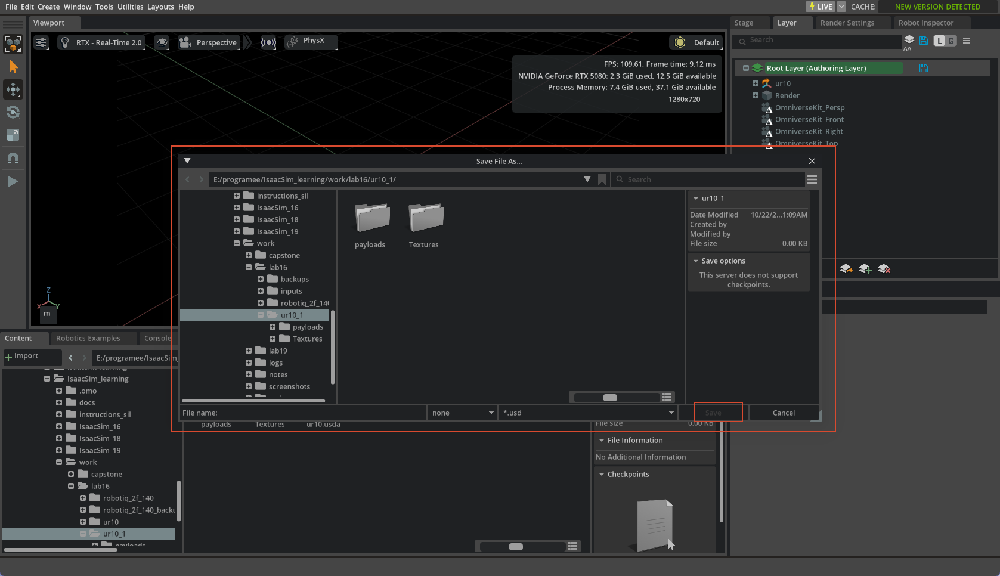
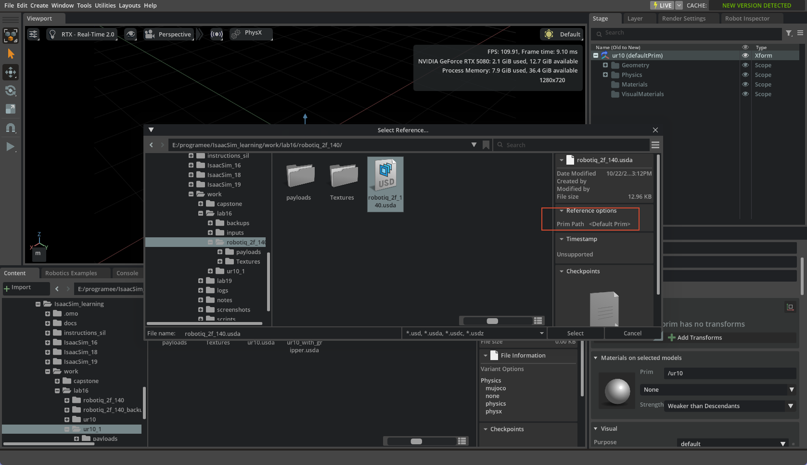
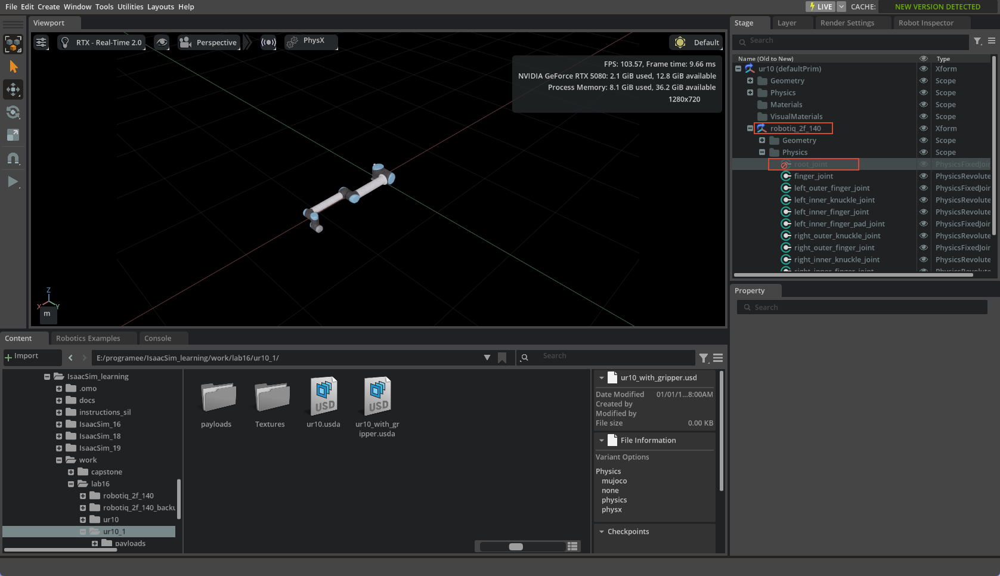
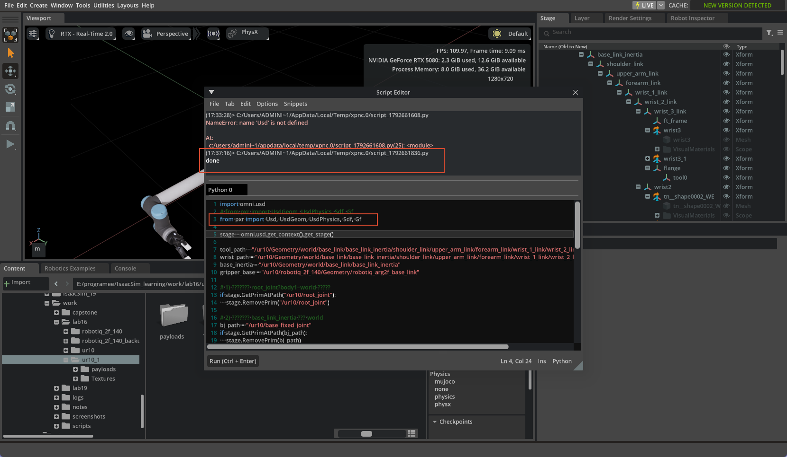
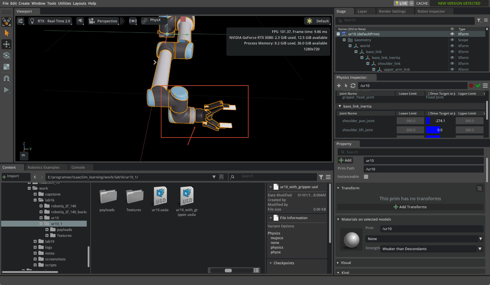
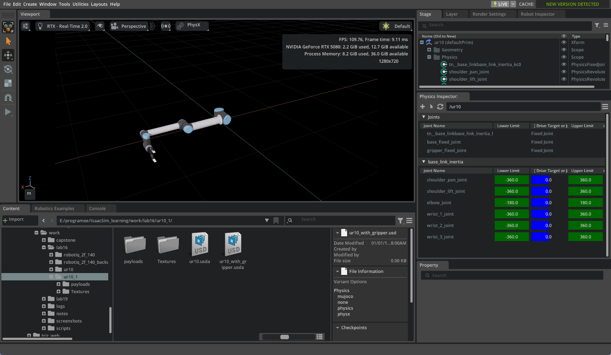
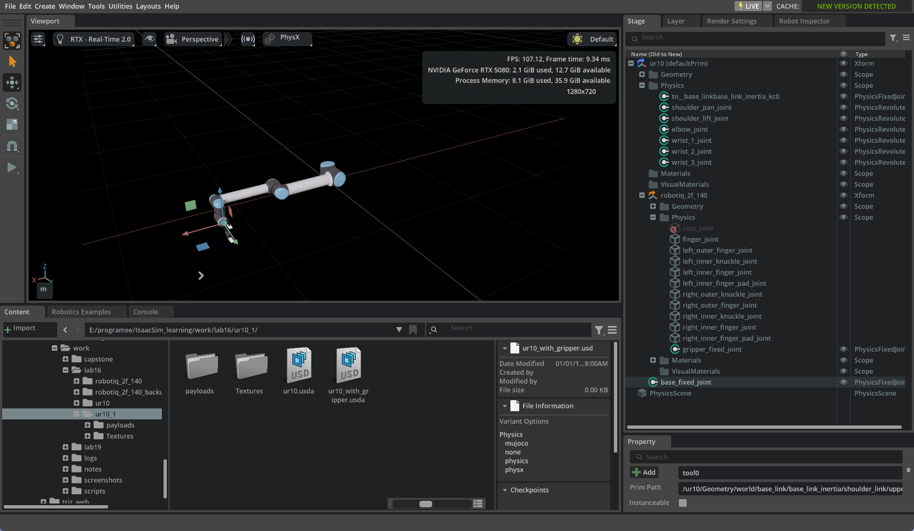

# Day 4 — 把 Robotiq 2F-140 组装到 UR10e（Isaac Sim 6.1）

> 版本：Isaac Sim 6.1.0.0 / Isaac Lab 3.0.0
> 日期：2026-10-22
> 预计耗时：60-90 分钟
> 官方参考：
> - Tutorial 6 Setup a Manipulator：https://docs.isaacsim.omniverse.nvidia.com/6.1.0/robot_setup_tutorials/tutorial_import_assemble_manipulator.html
> - Tutorial 10 Rig Closed-Loop Structures：https://docs.isaacsim.omniverse.nvidia.com/6.1.0/robot_setup_tutorials/rig_closed_loop_structures.html
> - Asset Structure 3.0：https://docs.isaacsim.omniverse.nvidia.com/6.1.0/robot_setup/asset_structure.html

---

## 1. 目标

学完这一章，你能：

- [ ] 用 `Save As` 创建独立的组装根层，不破坏原始 `ur10.usda`
- [ ] 把夹爪作为 Reference 挂到 `/ur10/robotiq_2f_140`
- [ ] 关闭夹爪自己的 `root_joint`
- [ ] 把夹爪对齐到 `tool0`
- [ ] 修复基座锚定和夹爪固定关节
- [ ] Play + Physics Inspector 验证：手臂能动、夹爪跟手

---

## 2. 前置条件

- Day 2 的 UR10e 资产：`work/lab16/ur10_1/ur10.usda`
- Day 3 的夹爪资产：`work/lab16/robotiq_2f_140/robotiq_2f_140.usda`
- 夹爪已按 5 关节 PhysxMimic 配置好

---

## 3. 创建组装文件（不要用 Create Sublayer）

1. `File > Open` 打开：
   `E:\programee\IsaacSim_learning\work\lab16\ur10_1\ur10.usda`
2. `File > Save As`
3. 保存到：
   `E:\programee\IsaacSim_learning\work\lab16\ur10_1\ur10_with_gripper.usda`

**必须放在 `ur10_1/` 里面**，因为 `ur10.usda` 用的是相对引用 `./payloads/base.usda`。

保存后 Stage 内容不会变，这是正常的：`Save As` 只是把根层另存为新文件；从此刻起新修改都写进 `ur10_with_gripper.usda`，原 `ur10.usda` 不动。

> **Create Sublayer 不是编辑层**：它在当前根层下面加一层，更弱；根层会覆盖它。组装要用 `Save As` 创建新根层，或 Content 右键 `Open With New Edit Layer`。



---

## 4. 引用夹爪

### 4.1 先建子 Xform

```
Stage > ur10  →  右键  →  Create > Xform
```

重命名为：

```
robotiq_2f_140
```

它必须是 `/ur10` 的子级，不能直接引用到 `/ur10` 上（否则 `/ur10` 会变成夹爪）。

### 4.2 加 Reference

```
Stage > ur10 > robotiq_2f_140  →  右键  →  Add > Reference
```

选：

`E:\programee\IsaacSim_learning\work\lab16\robotiq_2f_140\robotiq_2f_140.usda`

**Prim Path 保持 `<Default Prim>`**，点 Select。

### 4.3 关闭夹爪自己的 world 固定

```
Stage > ur10 > robotiq_2f_140 > Physics > root_joint
```

右键 → **Deactivate**（或 Property > Joint > Joint Enabled 取消）。

保存 `Ctrl+S`。



---

## 5. 把夹爪对齐到 tool0

6.1 的 `tool0` 完整路径：

```
/ur10/Geometry/world/base_link/base_link_inertia/shoulder_link/upper_arm_link/forearm_link/wrist_1_link/wrist_2_link/wrist_3_link/flange/tool0
```

在 `/ur10/robotiq_2f_140` 的 `Property > Transform` 填：

| 属性 | 值 |
|---|---|
| Translate | `(1.1843, 0.25614, 0.0116)` |
| Orient | `(-90, 0, 90)` |
| Scale | `(1, 1, 1)` |

> 不要直接复制 `tool0` 的局部 Transform 粘到夹爪 Xform：6.1 的 `tool0` 层级很深，局部 Transform 是相对 `flange` 的，不是相对 `/ur10`。上面这组数值就是 `tool0` 相对 `/ur10` 的精确变换。



---

## 6. 修复基座锚定和夹爪固定关节

### 6.1 为什么会失败

- `base_link` 只是 Xform；**`base_link_inertia` 才是刚体根**（带 `PhysicsRigidBodyAPI` + `ArticulationRootAPI`）。
- `world` 是空 Xform，不是刚体；`root_joint` 用 `world` 当 body，PhysX 报：
  `PhysicsUSD: CreateJoint - no bodies defined at body0 and body1`
- `tool0` 是坐标系，不是刚体；夹爪固定到 `tool0` 的关节无效。必须固定到 **`wrist_3_link`**（有 RigidBodyAPI）。

### 6.2 一键修复脚本

`Window > Script Editor` 运行：

```python
import omni.usd
from pxr import Usd, UsdGeom, UsdPhysics, Sdf, Gf

stage = omni.usd.get_context().get_stage()

tool_path = "/ur10/Geometry/world/base_link/base_link_inertia/shoulder_link/upper_arm_link/forearm_link/wrist_1_link/wrist_2_link/wrist_3_link/flange/tool0"
wrist_path = "/ur10/Geometry/world/base_link/base_link_inertia/shoulder_link/upper_arm_link/forearm_link/wrist_1_link/wrist_2_link/wrist_3_link"
base_inertia = "/ur10/Geometry/world/base_link/base_link_inertia"
gripper_base = "/ur10/robotiq_2f_140/Geometry/robotiq_arg2f_base_link"

# 1) 删掉无效的 root_joint（body1=world 不是刚体）
if stage.GetPrimAtPath("/ur10/root_joint"):
    stage.RemovePrim("/ur10/root_joint")

# 2) 把真正的刚体根 base_link_inertia 锚到 world
bj_path = "/ur10/base_fixed_joint"
if stage.GetPrimAtPath(bj_path):
    stage.RemovePrim(bj_path)
bj = UsdPhysics.FixedJoint.Define(stage, bj_path)
bj.CreateBody0Rel().SetTargets([])
bj.CreateBody1Rel().SetTargets([Sdf.Path(base_inertia)])

# 3) 夹爪 Xform 对齐到 tool0
root = stage.GetPrimAtPath("/ur10")
tw = UsdGeom.Xformable(stage.GetPrimAtPath(tool_path)).ComputeLocalToWorldTransform(Usd.TimeCode.Default())
rw = UsdGeom.Xformable(root).ComputeLocalToWorldTransform(Usd.TimeCode.Default())
local = tw * rw.GetInverse()
gr = stage.GetPrimAtPath("/ur10/robotiq_2f_140")
xf = UsdGeom.Xformable(gr)
xf.ClearXformOpOrder()
xf.AddTransformOp().Set(local)

# 4) 删掉旧的 gripper_fixed_joint（body1=tool0 不是刚体）
for prim in list(stage.Traverse()):
    if prim.GetName() == "gripper_fixed_joint":
        stage.RemovePrim(prim.GetPath())

# 5) 重建 gripper_fixed_joint：夹爪 base <-> wrist_3_link
Tg = UsdGeom.Xformable(stage.GetPrimAtPath(gripper_base)).ComputeLocalToWorldTransform(Usd.TimeCode.Default())
Tw = UsdGeom.Xformable(stage.GetPrimAtPath(wrist_path)).ComputeLocalToWorldTransform(Usd.TimeCode.Default())
L1 = Tw.GetInverse() * Tg

gj_path = "/ur10/robotiq_2f_140/Physics/gripper_fixed_joint"
gj = UsdPhysics.FixedJoint.Define(stage, gj_path)
gj.CreateBody0Rel().SetTargets([Sdf.Path(gripper_base)])
gj.CreateBody1Rel().SetTargets([Sdf.Path(wrist_path)])
gj.CreateLocalPos0Attr().Set(Gf.Vec3f(0, 0, 0))
gj.CreateLocalRot0Attr().Set(Gf.Quatf(1, 0, 0, 0))
v = L1.ExtractTranslation()
q = L1.ExtractRotationQuat()
gj.CreateLocalPos1Attr().Set(Gf.Vec3f(v[0], v[1], v[2]))
gj.CreateLocalRot1Attr().Set(Gf.Quatf(q.GetReal(), Gf.Vec3f(q.GetImaginary())))

stage.Save()
print("done")
```

> 第一行必须包含 `Usd`；否则 `Usd.TimeCode.Default()` 会报 `NameError: name 'Usd' is not defined`。



---

## 7. 验证

### 7.1 Play 后“没反应”是正常的

基座现在被 `base_fixed_joint` 固定，6 个关节的 Drive 又把手臂保持在当前姿态；没有目标变化时，机器人不会自己动。之前“会摆动”是基座浮空的 bug。

### 7.2 用 Physics Inspector 给目标

1. `Tools > Physics > Physics Inspector`
2. 选 `/ur10`，点 **refresh**
3. 找到 `shoulder_pan_joint`，拖动 **Drive Target** 滑块
4. 手臂应转动，夹爪应跟随手腕
5. 再选 `finger_joint`，把 Target Position 从 0 改到 40，夹爪开合



### 7.3 归零

1. **Stop**
2. `Stage > ur10 > Physics > shoulder_pan_joint` → `Property > Drive > Angular > Target Position = 0`
3. 对 6 个关节重复
4. **Play**，手臂回到零位

或用脚本：

```python
import omni.usd
from pxr import UsdPhysics

stage = omni.usd.get_context().get_stage()
for name in ["shoulder_pan_joint","shoulder_lift_joint","elbow_joint","wrist_1_joint","wrist_2_joint","wrist_3_joint"]:
    p = stage.GetPrimAtPath(f"/ur10/Physics/{name}")
    d = UsdPhysics.DriveAPI.Get(p, "angular")
    if d:
        d.GetTargetPositionAttr().Set(0.0)
        print("reset", name)
stage.Save()
print("done")
```



---

## 8. 踩坑记录

| 现象 | 原因 | 解决 |
|---|---|---|
| `Create Sublayer` 不是编辑层 | Sublayer 在根层下面，更弱 | 用 `File > Save As` 创建新根层 |
| Save As 后 Stage 没变化 | 只是另存根层，内容不变 | 正常；后续修改写进新文件 |
| 夹爪 Reference 后 `/ur10` 变了 | 直接引用到 `/ur10` 上会覆盖 | 先建子 Xform `/ur10/robotiq_2f_140` |
| `root_joint` 报 `no bodies defined` | `world` 是空 Xform，不是刚体 | 锚 `base_link_inertia`，body0 为空 |
| 基座会摆动 | 6.1 导入器缺少 world→base 固定 | 加 `base_fixed_joint` 到 `base_link_inertia` |
| 夹爪固定关节无效 | `tool0` 是坐标系，不是刚体 | 固定到 `wrist_3_link` |
| Property 显示 Body 1 像 base_link | 长路径被截断 | 读文件/关系确认；实际是 tool0 |
| Play 没反应 | 没有 Drive Target 变化 | 用 Physics Inspector 给目标 |
| `NameError: Usd` | import 漏了 `Usd` | `from pxr import Usd, UsdGeom, UsdPhysics, Sdf, Gf` |

---

## 9. 最终资产结构

```text
ur10_1/
├── ur10.usda                 ← 原始 UR10e（不改）
├── ur10_with_gripper.usda    ← 组装根层
├── Textures/
└── payloads/
    └── ...（UR10e 物理/几何）
```

`ur10_with_gripper.usda` 里新增：

```text
/ur10
├── base_fixed_joint                     ← body0 空，body1 base_link_inertia
└── robotiq_2f_140                       ← 夹爪 Xform，Transform = tool0
    ├── Geometry/...
    └── Physics
        └── gripper_fixed_joint          ← body0 夹爪 base，body1 wrist_3_link
```



---

## 10. 英文词汇

| English | 中文 | 说明 |
|---|---|---|
| Root Layer | 根层 | 当前 stage 最上面的层 |
| Edit Layer | 编辑层 | 用于非破坏性叠加修改 |
| Sublayer | 子层 | 根层下面的弱层 |
| Reference | 引用 | 把另一个 USD 当组件 |
| Deactivate | 停用 | 关闭 prim/joint |
| Rigid Body | 刚体 | 有 PhysicsRigidBodyAPI |
| Articulation Root | 关节树根 | 整台机器人的根 |
| Fixed Joint | 固定关节 | 连接两个刚体 |
| Tool Frame (`tool0`) | 工具坐标系 | 不是刚体 |
| Wrist Link | 手腕连杆 | 末端刚体 |
| Drive Target | 驱动目标 | 关节目标位置/速度 |
| Physics Inspector | 物理检查器 | 拖 Drive Target 验证 |

---

## 11. 下一步

→ Day 5：Asset Structure 3.0 + 资产优化（Scene Optimizer / 实例化）
