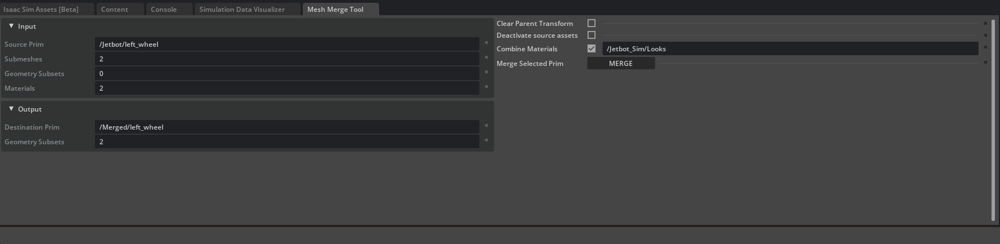
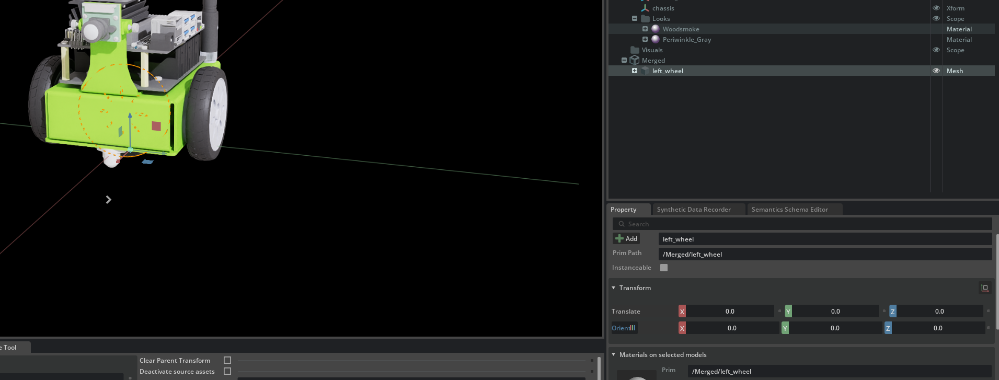
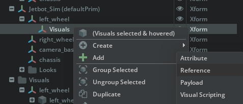
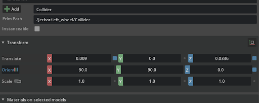
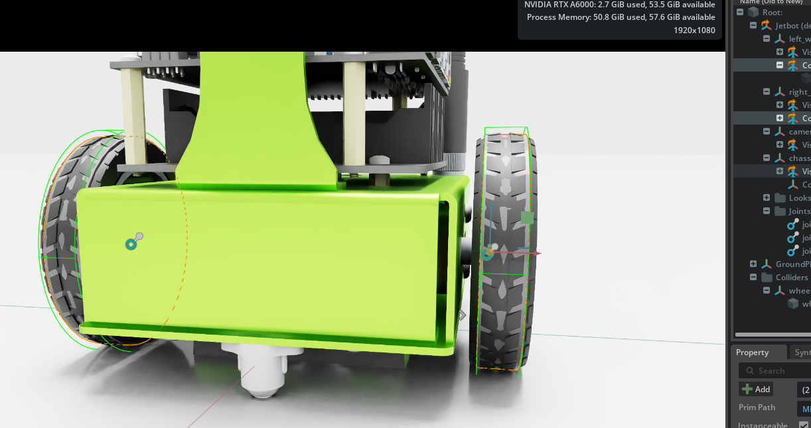

# 06 资产优化：Jetbot 网格合并、实例化与碰撞体

> 目标：理解 Lab 16 模块 6 的三类优化：Mesh Merge、Scenegraph Instancing、Collider Best Practices。  
> **状态：完成。**  
> Mesh Merge、Instancing、Collider 三步均已实操完成。  
> - Mesh Merge：`jetbot_m6_merged.usd`，`/Merged/left_wheel` 是 1 个 Mesh + `Periwinkle_Gray` / `Woodsmoke` 两个 GeomSubset  
> - Instancing：`jetbot_m6_instanced.usd`，`558` 个 instanceable prim，`3` 个 Mesh  
> - Collider：`jetbot_m6_physics.usd`，左右轮共享 `/Collisions/wheel`，旧 `Visuals` Collider 已删除

---

## 工作副本

本次 M6 使用：

```text
work/lab16/jetbot/Jetbot_Optimized/jetbot_m6_work.usd
work/lab16/jetbot/Jetbot_Base/Jetbot_base.usd
```

官方最终资产放在同一目录下，作为对照；不要修改 `IsaacSim_16` 原始资料。

---

## 前置

- 已完成 02 UR10e 导入、03 2F-140 夹爪、04 组装。
- 已确认 Isaac Sim 6.1 的 `Stage / Layer / Reference / Physics` 基本操作。
- M6 使用旧 GTC 4.5 的 Jetbot 资产；这些资产是静态几何 + 物理层，不依赖 4.5 运行时，可直接在 6.1 打开。

---

## 资产位置

| 用途 | 路径 |
|---|---|
| 原始 Jetbot | `IsaacSim_16/16_USD_FOR_ROBOTICS/Jetbot/Jetbot.usd` |
| 合并后（未实例化） | `.../Jetbot/Jetbot_Optimized/Jetbot_optimized_post_merge.usd` |
| 合并 + 实例化最终版 | `.../Jetbot/Jetbot_Optimized/Jetbot_optimized_final.usd` |
| 物理/碰撞体初始版 | `.../Jetbot/Jetbot_physics/Jetbot_physics.usd` |
| 碰撞体最终版 | `.../Jetbot/Jetbot_physics/Jetbot_physics_final.usd` |

---

## 1. 网格合并（Mesh Merge）

### 目的

Jetbot 是 Onshape CAD 导入的模型，主体由大量小网格组成。每个小网格都是一个 draw call / 物理对象候选，仿真和渲染都慢。把同一部件的多个网格合并成一个，减少 prim 数量。

### 6.1 适配：Mesh Merge Tool 已经移除

4.5 旧教程里的：

```text
Tools > Robotics > Asset Editors > Mesh Merge Tool
```

在 **Isaac Sim 6.1** 已经不存在。当前 `Asset Editors` 里只有：

- Gain Tuner
- Robot Assembler
- Robot Self-Collision Detector
- Asset Transformer

6.1 的替代方案是 **Scene Optimizer**：

```text
Window > Utilities > Scene Optimizer
```

### 方案 A：Scene Optimizer UI

1. 打开 `Window > Utilities > Scene Optimizer`
2. 点击 `+` / **Add Scene Optimizer Process**
3. 选择 **Merge Static Meshes**
4. 在 **Static Meshes to Merge** 中加入这两个 mesh prim：
   - `/Jetbot/left_wheel/_WD_tyre/_WD_tyre`
   - `/Jetbot/left_wheel/_WD_buggy_wheel_v5_1_1/_WD_buggy_wheel_v5_1_1`
5. 设置：
   - **Merge Boundary** = `Stage`
   - **Output Name** = `/Merged/left_wheel`
   - **Original Mesh Handling** = `Deactivate`
   - **Keep Materials Separate** = 关闭
   - **Allow Single Meshes** = 开启
6. 点击执行该操作

> 注意：不能只选 `/Jetbot/left_wheel` 这个 Xform；Scene Optimizer 的 Merge 需要具体的 Mesh prim。轮子的 Mesh 在引用/实例代理里，所以路径是上面那两个。

### 方案 B：Script Editor（推荐，路径最稳）

```python
import omni.kit.commands

omni.kit.commands.execute(
    "SceneOptimizerOperation",
    operation="merge",
    args={
        "meshPrimPaths": [
            "/Jetbot/left_wheel/_WD_tyre/_WD_tyre",
            "/Jetbot/left_wheel/_WD_buggy_wheel_v5_1_1/_WD_buggy_wheel_v5_1_1",
        ],
        "considerMaterials": False,
        "originalGeomOption": 2,
        "mergePoint": 0,
        "rootPath": "/Merged/left_wheel",
        "allowSingleMeshes": True,
    },
)
```

预期：

```text
INFO: Merged 2 meshes into 1 mesh
```

结果：

```text
/Merged/left_wheel
├─ Periwinkle_Gray   (GeomSubset)
└─ Woodsmoke         (GeomSubset)
```

`/Merged/left_wheel` 本身是一个 Mesh，两个 GeomSubset 对应两种材质。  
控制台可能出现 `authoring to an instance proxy` 警告，但 merge 仍然成功；以 `Merged 2 meshes into 1 mesh` 和 `/Merged/left_wheel` 是否存在为准。

### 保存

另存为：

```text
work/lab16/jetbot/Jetbot_Optimized/jetbot_m6_merged.usd
```

> 下面的截图来自 4.5 旧界面，仅作为“合并结果长什么样”的历史参考；6.1 的实际操作以 Scene Optimizer 为准。







### 验收指标

- `Jetbot_optimized_post_merge.usd`：**8 个 Mesh**，554 个 instanceable prim，558 个 reference。
- `Jetbot_optimized_final.usd`：**3 个 Mesh**，558 个 instanceable prim，558 个 reference。

Mesh 数从 8 降到 3，说明轮子和主体已经合并；instanceable 数增加，说明实例化完成。

---

## 2. 场景图实例化（Scenegraph Instancing）

### 目的

左右轮几何完全相同。让两个轮子引用同一个内部 `Visuals/wheel`，再勾选 **Instanceable**，场景图只保留一份网格数据，两个轮子共享。

> **重要：post_merge 的 Stage 有多个根 prim。**
>
> ```text
> /Jetbot              原始/参考车，忽略
> /Jetbot_optimized    最终资产（defaultPrim），Instancing 在这里做
> /Visuals             共享视觉源，rename/delete 在这里做
> /Merged              合并结果，作为参考
> ```
>
> 不要改 `/Jetbot`；只操作 `/Jetbot_optimized` 和 `/Visuals`。

### 官方流程

1. 把 `/Visuals/left_wheel` 重命名为 `/Visuals/wheel`。
2. 删除 `/Visuals/right_wheel`。
3. 选中 `/Jetbot_optimized/right_wheel/Visuals`，把 Reference 的 Prim Path 从 `/Visuals/right_wheel` 改为 `/Visuals/wheel`。
4. 检查 `/Jetbot_optimized/left_wheel/Visuals` 的 Reference；如果重命名后它也断了，同样改为 `/Visuals/wheel`。
5. 选中 `/Jetbot_optimized` 下所有 `Visuals` prim（left_wheel、right_wheel、camera_base、chassis），在 Property 面板勾选 **Instanceable**。
6. 保存。

### 验收指标

- `Jetbot_optimized_final.usd`：**558 个 instanceable prim**。
- 引用图标出现蓝色“I”，表示实例化生效。

---

## 3. 碰撞体最佳实践（Colliders）

### 目的

默认 Convex Hull 对车轮和底盘过于保守，会导致滚动不准确和碰撞异常。车轮用圆柱体近似，底盘用简化碰撞体，比 Convex Hull 更稳定、更便宜。

### 官方流程

1. 打开 `Jetbot_physics.usd`。
2. `眼睛图标 > Show by Type > Physics > Colliders > Selected` 查看碰撞体。
3. 在每个车轮和底盘下创建 `Collider` Xform。
4. 车轮碰撞体使用 **Cylinder**：
   - Translate `(0, 0, 0.003)`
   - Radius `0.035`
   - Height `0.015`
5. 在根下创建 `Colliders` scope；在 `Colliders/wheel` 下放圆柱体，并重命名为 `wheel`。
6. 左右车轮的 `Collider/wheel` 通过内部 Reference 指向 `/Colliders/wheel`。
7. 勾选 **Instanceable**，给碰撞体加 `Physics > Collider`。
8. 把 `/Colliders/wheel/wheel` 的 Visual Purpose 改为 **guide**，隐藏碰撞体显示。
9. 删除车轮 `Visuals` 上原来的 Collider。





### 验收指标

- `Jetbot_physics_final.usd`：**1 个 Mesh，7 个 Collider**，6 个 instanceable prim。
- 车轮碰撞体是圆柱体，不是 Convex Hull；底盘碰撞体不再包住天线外形。

---

## 官方最终资产核对结果（非实操）

| 文件 | Mesh 数 | Collider 数 | Instanceable | Reference |
|---|---:|---:|---:|---:|
| `Jetbot_optimized_post_merge.usd` | 8 | 0 | 554 | 558 |
| `Jetbot_optimized_final.usd` | 3 | 0 | 558 | 558 |
| `Jetbot_physics_base.usd` | 1 | 4 | 556 | 557 |
| `Jetbot_physics_final.usd` | 1 | 7 | 6 | 7 |

结论：

- **Mesh Merge**：8 → 3 个 Mesh。
- **Instancing**：558 个 instanceable prim。
- **Colliders**：4 → 7 个 Collider，但形状从 Convex Hull 改为圆柱/简化碰撞体，质量更高。

> 本次 hands-on 结果：`jetbot_m6_physics.usd` 为 **1 Mesh、5 个 CollisionAPI、6 个 Instanceable**。  
> 比官方 final 少 2 个 CollisionAPI，是因为按 Lab 要求删除了左右轮 `Visuals` 上的旧 Collider；这是更干净的最终状态。

---

## 6.1 适配说明

- **6.1 已移除 `Tools > Robotics > Asset Editors > Mesh Merge Tool`**，改用 `Window > Utilities > Scene Optimizer` 的 **Merge Static Meshes**。
- 如果菜单里没有 Scene Optimizer，在 `Window > Extensions` 里启用 `Scene Optimizer` bundle。
- 6.1 的 Xform Transform 默认用 **Orient 四元数**；旧教程的 `(90,90,0)` 对应 `(0.5,0.5,0.5,0.5)`，不要同时叠加 Rotate 和 Orient。
- `Add > Reference` 对话框选的是 **USD 文件**；`/Collisions/wheel` 是文件内的 **Prim Path**，要填在 Reference options 里。
- Jetbot 资产来自 4.5 实验包，但它们是静态 USD，不依赖 4.5 Python 扩展；6.1 可直接打开。
- 本模块不涉及夹爪闭链，因此没有 6.1 importer 的 `NewtonMimicAPI` 问题。

---

## 验证清单

- [x] Mesh Merge 实操：`/Merged/left_wheel` = 1 Mesh + `Periwinkle_Gray` / `Woodsmoke`
- [x] Instancing 实操：左右轮引用 `/Visuals/wheel`，`558` 个 instanceable prim，`3` 个 Mesh
- [x] Collider 实操：左右轮 `Collider` 引用 `/Collisions/wheel`，`Instanceable`
- [x] 旧 `Visuals` Collider 已删除
- [x] `Cylinder` Purpose = `guide`
- [x] 保存 `jetbot_m6_merged.usd` / `jetbot_m6_instanced.usd` / `jetbot_m6_physics.usd`

---

## 英文词汇

| 英文 | 中文 |
|---|---|
| Mesh Merge | 网格合并 |
| Scenegraph Instancing | 场景图实例化 |
| Instanceable | 可实例化 |
| Collider | 碰撞体 |
| Convex Hull | 凸包 |
| Visual Purpose | 视觉用途 |
| Guide | 辅助显示 |
| Draw Call | 绘制调用 |

---

## 下一步

M6 已完成，Lab16 的 M1-M6 全部完成。

本地产物：

```text
work/lab16/jetbot/Jetbot_Optimized/jetbot_m6_merged.usd
work/lab16/jetbot/Jetbot_Optimized/jetbot_m6_instanced.usd
work/lab16/jetbot/Jetbot_physics/jetbot_m6_physics.usd
```

下一步：进入 Lab19 SMMG（Isaac Lab + 模仿学习）。
