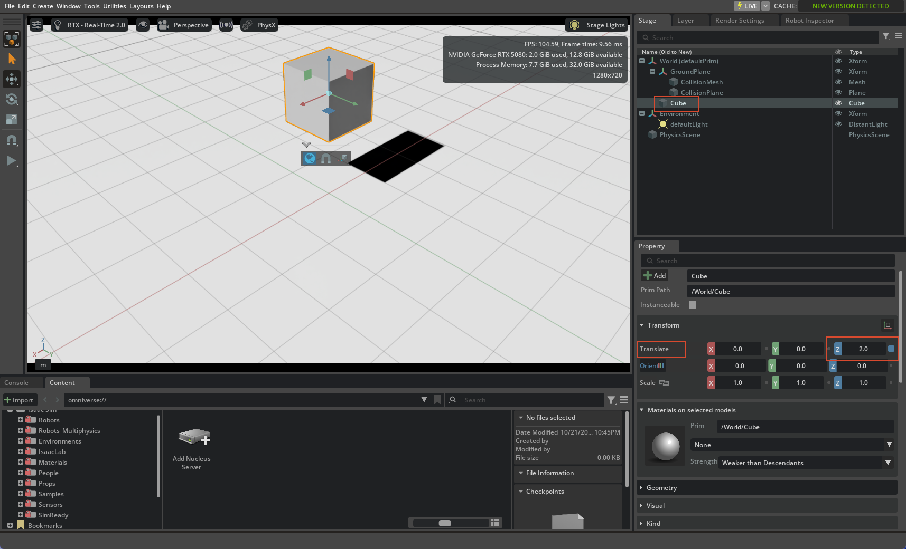

# 01 Isaac Sim 基础：Stage、Prim、Physics 与 Joint

> 目标：理解 Isaac Sim 里“机器人资产”到底是什么，为 Lab16 的 URDF 导入和组装打基础。

---

## 1. 四个核心概念

| 概念 | 含义 | 在机器人里的对应 |
|---|---|---|
| **Stage** | 当前打开的场景树 | 整个仓库/机器人场景 |
| **Prim** | Stage 里的一个节点 | Link、Joint、Mesh、Scope、Xform |
| **API Schema** | 给 Prim 附加的能力 | `PhysicsRigidBodyAPI`、`PhysicsCollisionAPI`、`PhysicsDriveAPI` |
| **Layer / Reference** | 组合和复用 USD 的方式 | 机器人资产、夹爪资产、场景资产 |

---

## 2. URDF 与 USD 的对应关系

| URDF | USD / Isaac Sim |
|---|---|
| Link | `Xform` + `PhysicsRigidBodyAPI` + `PhysicsMassAPI` |
| Joint | `PhysicsRevoluteJoint` / `PhysicsPrismaticJoint` / `PhysicsFixedJoint` |
| Visual mesh | `Mesh` + `Material` |
| Collision mesh | `Mesh` + `PhysicsCollisionAPI` |
| Robot | **Articulation**（刚体 + 关节树） |
| Fixed joint | `PhysicsFixedJoint`，把两个刚体固定在一起 |

> 重要：**不是所有 Xform 都是刚体**。  
> `base_link` 可能只是 Xform；真正参与物理的是 `base_link_inertia`。  
> `tool0` 也可能只是 frame，不是刚体；夹爪要锚到 `wrist_3_link`。

---

## 3. 关节类型

`IsaacSim_16/16_USD_FOR_ROBOTICS/joint_types.usd` 里有 14 个关节 prim，覆盖：

- `PhysicsPrismaticJoint`：直线关节
- `PhysicsRevoluteJoint`：旋转关节
- `PhysicsSphericalJoint`：球关节
- `PhysicsDistanceJoint`：距离关节
- `PhysicsJoint`（D6）：六自由度可配置关节
- `PhysicsFixedJoint`：固定关节
- `PhysxPhysicsGearJoint`：齿轮耦合
- `PhysxPhysicsRackAndPinionJoint`：齿轮齿条
- Mimic：主动关节 + 随动关节


---

## 4. Physics Variant

6.1 的机器人资产通常带一个 `Physics` variant：

- `physx`
- `mujoco`
- `physics`
- `none`

在 Isaac Sim 里做 PhysX 仿真时，要把根 prim 的 **Variants > Physics** 设为 **`physx`**。  
如果没选，关节/Drive/Mimic 可能不完整，表现为：

- Play 后机器人软塌
- 关节列表为空
- 夹爪没有约束

---

## 5. Layers 与 References

机器人资产通常不是单个文件，而是：

```text
robot.usda
├─ payloads/base.usda
├─ payloads/geometries.usd
├─ payloads/instances.usda
├─ payloads/materials.usda
└─ payloads/Physics/physx.usda
```

根层只放：

- 关节调参
- 组装后的 Fixed Joint
- 场景级覆盖

> 不要把调参写进 `payloads/` 原始层；否则回退和复用会很痛苦。

---

## 6. 第一个练习：立方体下落

1. `File > New`
2. `Create > Physics > Ground Plane`
3. `Create > Shape > Cube`
4. 给 Cube 加 `Rigid Body` 和 `Collider`
5. Play，确认立方体受重力下落



---

## 7. 第二个练习：读 joint_types.usd

打开：

```text
<ISAAC_16_ROOT>/16_USD_FOR_ROBOTICS/joint_types.usd
```

在 Stage 里展开 `/World`，逐个点关节，看 Property 面板。

重点观察：

- 关节类型
- Body0 / Body1
- Local Position / Rotation
- Axis
- Limits

---

## 8. 验证清单

- [x] 能解释 Stage / Prim / API / Layer / Reference
- [x] 能说出 URDF Link / Joint 对应 USD 的什么
- [x] 能区分 `base_link` 和 `base_link_inertia`
- [x] 能区分 `tool0` 和 `wrist_3_link`
- [x] 能找到 Physics Variant 并设为 `physx`
- [x] 能打开 `joint_types.usd` 并识别至少 5 种关节

---

## 9. 下一步

- [Lab16 总览](../lab16/00_overview.md)
- [Lab16 M1 资产结构](../lab16/01_asset_structure.md)
